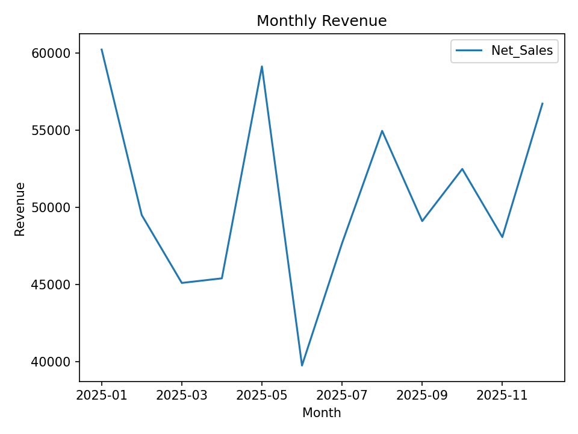
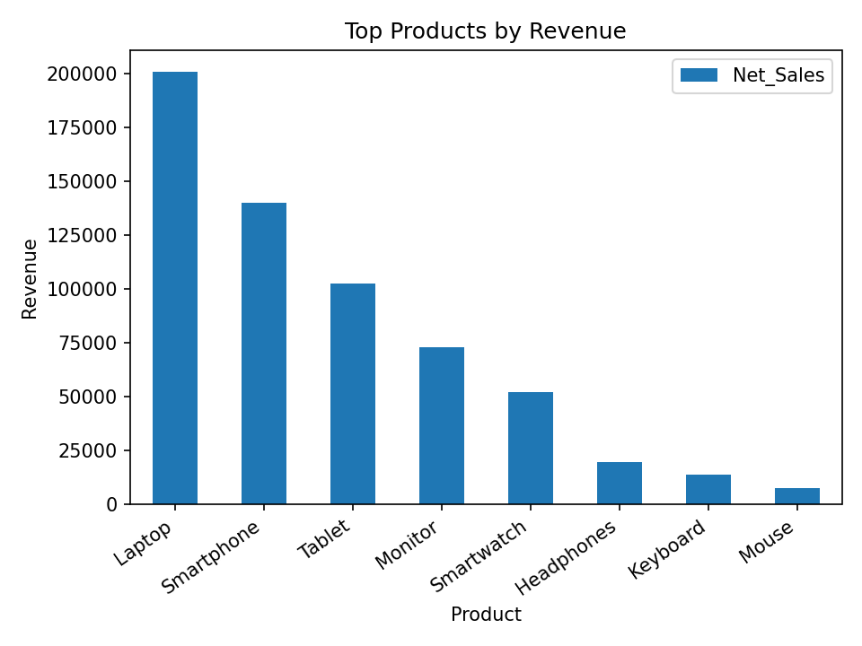

# Retail Store Sales Analysis

## 📊 Project Overview

A data analytics project focused on analyzing retail transaction data to identify sales trends, top-performing products, regional performance, sales channels, and key business KPIs.

## 🎯 Objectives

- Analyze overall sales performance and revenue trends.
- Identify top-performing products and regions.
- Compare online and store sales channels.
- Calculate key business KPIs such as revenue, units sold, average order value, and estimated profit.
- Prepare clean, analysis-ready data for reporting and visualization.

## 🛠️ Tools & Technologies

- Python
- Pandas
- NumPy
- Matplotlib
- SQL
- Excel
- Power BI
- Git & GitHub

## 🔄 Project Workflow

1. Structured retail transaction data.
2. Cleaned and prepared the dataset using Python and Pandas.
3. Created calculated fields for monthly sales, discounts, and estimated profit.
4. Analyzed revenue by month, product, region, category, and channel.
5. Created visualizations to identify important sales trends.
6. Developed SQL queries for business KPI analysis.
7. Prepared a Power BI dashboard structure for interactive reporting.

## 📈 Key KPIs

- Total Revenue
- Units Sold
- Average Order Value
- Estimated Profit
- Monthly Revenue
- Product-wise Revenue
- Region-wise Revenue
- Channel-wise Revenue

## 📁 Project Files

| File | Description |
|---|---|
| `raw_retail_sales.csv` | Raw sample transaction data |
| `cleaned_retail_sales.csv` | Cleaned analysis-ready dataset |
| `analysis.py` | Python analysis and visualizations |
| `analysis_queries.sql` | SQL analysis queries |
| `retail_sales_analysis.xlsx` | Excel analysis workbook |
| `POWER_BI_DASHBOARD.md` | Power BI dashboard guide |
| `monthly_revenue.png` | Monthly revenue visualization |
| `top_products.png` | Top products visualization |
| `requirements.txt` | Python dependencies |

## 📊 Visualizations

### Monthly Revenue Trend



### Top Products by Revenue



## 💡 Business Insights

The analysis helps identify:

- Products generating the highest revenue.
- Monthly sales trends and changes.
- Regions with stronger sales performance.
- Differences between online and store sales.
- Opportunities for data-driven sales and inventory decisions.

## ▶️ How to Run

Install the required Python libraries:

```bash
pip install -r requirements.txt
